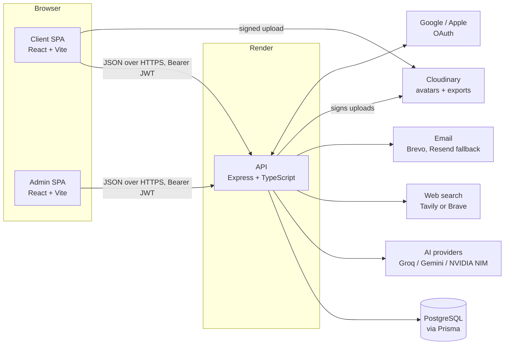
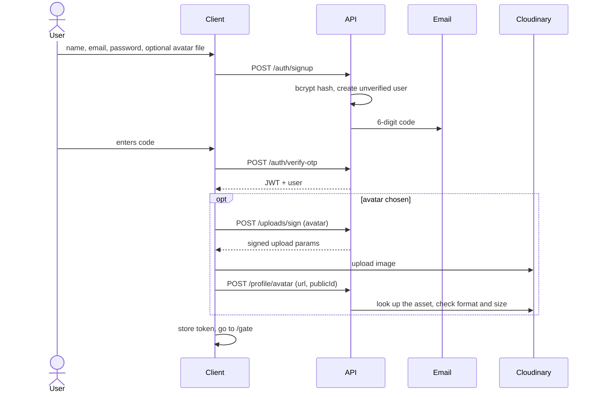
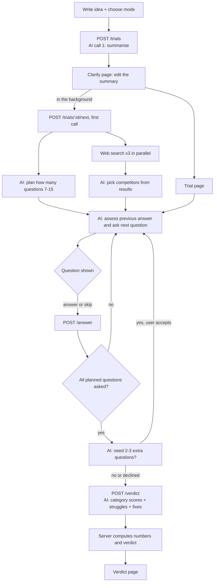
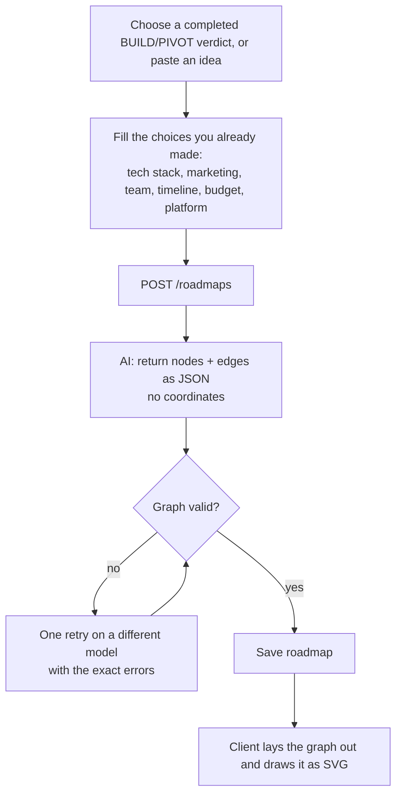
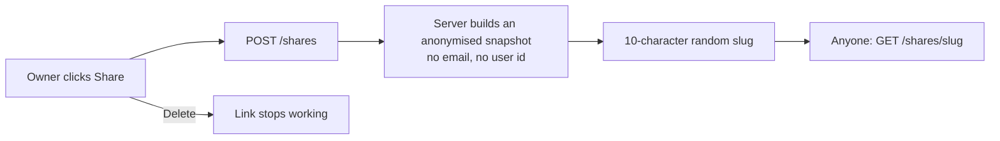
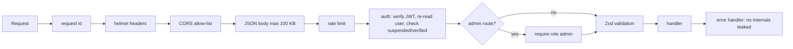
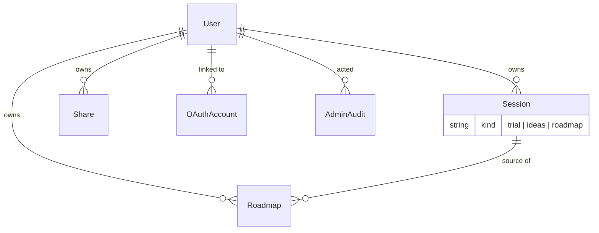

# ChallengeX

ChallengeX pressure-tests a startup idea. You describe it, an AI "interrogator" asks 7–15 hard questions across seven risk areas, and the server turns your answers into a score and a **KILL / PIVOT / BUILD** verdict. Ideas that survive can be turned into a **graphical roadmap**. Verdicts and roadmaps can be shared by a public link.

This file is the only documentation. It covers what each part does, why it was chosen, how data flows, how to run and deploy it, and how to make the AI parts faster.

- [1. What the app does](#1-what-the-app-does)
- [2. Architecture and tech choices](#2-architecture-and-tech-choices)
- [3. How things work (flow charts)](#3-how-things-work)
- [4. Scoring rules](#4-scoring-rules)
- [5. Data model](#5-data-model)
- [6. API overview](#6-api-overview)
- [7. Run locally](#7-run-locally)
- [8. Configuration reference](#8-configuration-reference)
- [9. Deploy on Render](#9-deploy-on-render)
- [10. Security](#10-security)
- [11. Why question and roadmap generation are slow, and how to fix it](#11-speed)
- [12. Project layout](#12-project-layout)

## 1. What the app does

| Feature | What happens |
|---|---|
| **Challenge** | Pick a mode, write the idea (20–2000 chars). The AI summarises it (problem, target users, solution). You confirm or edit, then answer one question at a time. You may skip a question (costs score). |
| **Modes** | Stress Test (balanced), Brutal (assume the worst), 100x (what breaks at 100× load), Competitor (rivals and switching costs), Failure ("it failed in 12 months, why?"). |
| **Verdict** | Per-category scores, the answers that hurt most, fixes, 2–3 alternative directions, and one cheap validation experiment. |
| **Roadmap** | For BUILD/PIVOT ideas: a directed graph of 12–26 steps over six stages (validate → spec → design → blueprint → prototype → launch), with decision nodes for things you have not chosen yet, drawn as an SVG graph. |
| **Ideas generator** | Suggests three ideas from hobbies, skills and interests, grounded by one web search. |
| **Share** | A public, revocable read-only link to a verdict or roadmap. It contains no email or user id. |
| **Accounts** | Email + password with emailed codes, optional Google/Apple sign-in, optional avatar on sign-up, profile, history, saved items. |
| **Admin console** | Separate site: dashboard, users (suspend/promote/delete), sessions, shares, AI model health, audit log. |

## 2. Architecture and tech choices



| Piece | Used for | Why |
|---|---|---|
| **Node 20 + Express 4 + TypeScript (strict)** | API | Small, well known, easy to host. Strict types catch shape mismatches early. |
| **Zod** | Validating every request body and every AI reply | One schema is both the runtime check and the TypeScript type. AI output is never trusted. |
| **Prisma + PostgreSQL** | Persistence | Works on any Postgres host (Supabase, Neon, Render, Railway). One `DATABASE_URL`. |
| **JWT (HS256, 7 days) + bcrypt** | Sessions and passwords | Stateless tokens, but the user row is re-read on every request so a suspension takes effect at once. |
| **OTP by email** | Verify email, reset password | Codes are HMAC-hashed, single use, expire in 10 min, locked after 5 wrong tries. |
| **OpenAI-compatible AI providers** | Questions, verdicts, roadmaps | Groq, Gemini and NVIDIA all speak the same API, so a pool of models from several providers gives automatic failover. |
| **Tavily / Brave search** | Competitor research | Gives the model real competitor names and URLs; model-invented URLs are discarded. |
| **Brevo → Resend** | Email | Brevo first, Resend if Brevo fails. No SMTP. |
| **Cloudinary (signed uploads)** | Avatars, exports | The browser uploads straight to Cloudinary using a signature the server creates with a fixed folder, formats and size, so files never pass through the API. |
| **React 18 + Vite + Tailwind 4** | Client and admin | Fast builds; the client is also an installable PWA. |
| **React Query** | Client data fetching | Caching and retry. |
| **react-hook-form + Zod** | Client forms | Same validation library as the server. |
| **Hand-written SVG** | Roadmap graph, charts | No charting dependency; the roadmap layout is about 100 lines. |
| **WebGL / canvas scenes** | Gothic background art in the client | Visual identity only; not needed for the logic. |
| **Zustand** | Admin session state | Tiny store for the admin console. |

## 3. How things work

### 3.1 Sign-up, verification and sign-in



The avatar is uploaded after the email is verified, because signing needs a logged-in user. If the upload fails the account is still created and the user is told to add it later on the profile page.

Sign-in with Google/Apple: the browser goes to `/api/auth/oauth/<provider>`, the API sets a random `state` cookie and redirects to the provider, the provider returns to `<API_PUBLIC_URL>/api/auth/oauth/<provider>/callback`, the API checks the state, verifies the ID token signature against the provider's public keys, finds or creates the user, and redirects to `<FRONTEND_URL>/oauth/callback#access_token=…`. The token is in the URL fragment so it never reaches a server log, and the page removes it from the address bar.

### 3.2 A challenge from idea to verdict



Rules the server enforces, because the model cannot be relied on:

- All seven categories must be asked before the interrogation may end; if the model breaks this the server asks once for a correction and then substitutes a built-in question.
- Each question is stored on the session before it is shown, so a reload shows the same question instead of generating a new one.
- Writes use a version number (optimistic locking). If two requests race, the loser re-reads instead of overwriting.
- The AI only suggests scores. The server snaps them to 0.5 steps, applies skip penalties, and computes the total and verdict itself.
- "Struggle" quotes are cut from your stored answers by the server, not written by the model.

### 3.3 Roadmap generation



The graph must satisfy: 12–26 nodes, all six stages present, unique ids, edges point at real nodes, no cycles, exactly one start, at least one end, every `decision` node has exactly one `recommended` and at least one `alternate` edge, every field you left undecided has a decision node, and every `high` difficulty node on the main path explains why and names a better alternative.

**How the graph is drawn** (`client/src/components/roadmap/RoadmapGraph.tsx`): one column per stage, left to right. Inside a column, each step is placed at the average height of the steps that lead into it, then pushed down if it would overlap. Edges are curves: solid red for the recommended path, grey for normal, dashed amber with a label for alternates. Click a step to highlight its connections and show full details; the +/− buttons zoom. The same component is used on the public share page.

### 3.4 Sharing



Deleting a trial also deletes its share links.

### 3.5 Request protection



## 4. Scoring rules

- Seven categories: technical, market, social, financial, legal, scalability, competition.
- The AI gives each a score from 0 to 10; the server snaps it to the nearest 0.5.
- Each skipped question lowers its category by 0.5 (never below 0).
- **Total = average of the seven × 10, rounded** (0–100).
- **KILL** below 40, **PIVOT** 40–69, **BUILD** 70 and above.
- The verdict is marked *lower confidence* if more than 3 questions were skipped or the user declined the extra round.

## 5. Data model



- **User**: email, bcrypt hash (empty for OAuth-only), role (`user`/`admin`), status (`active`/`suspended`), avatar.
- **Session**: one table for all history. A trial holds the idea, understanding, competitors, the question/answer list, assumptions, scores and verdict. `ideas` and `roadmap` rows are history entries.
- **Roadmap**: the input choices and the graph (JSON).
- **Share**: slug, anonymised snapshot, revoked flag. **Otp**: hashed codes. **AiEvent**: model, success, latency (no prompts). **AdminAudit**: who did what.
- The columns `ideaIv`, `recoveryKeyHash` and `recoveryKeySet` are left over from a removed encryption attempt. Nothing reads them; they can be dropped in a later migration.

## 6. API overview

All routes are under `/api`. `Bearer <jwt>` unless noted.

| Area | Routes |
|---|---|
| Health | `GET /health` (no auth, no database) |
| Auth (no token) | `POST /auth/signup`, `/auth/verify-otp`, `/auth/resend-otp`, `/auth/login`, `/auth/forgot`, `/auth/reset` |
| Account | `GET/PATCH /auth/me` |
| OAuth | `GET /auth/oauth/google`, `/google/callback`, `/apple`; `POST /apple/callback` |
| Trials | `POST /trials`, `GET /trials` (filters `kind`, `saved`), `GET/DELETE /trials/:id`, `PATCH /:id/understanding`, `POST /:id/next`, `/answer`, `/extend`, `/verdict`, `/save` |
| Ideas | `POST /ideas` |
| Roadmaps | `POST /roadmaps`, `GET /roadmaps`, `GET /roadmaps/:id`, `GET /roadmap-sources` |
| Shares | `POST /shares`, `DELETE /shares/:slug`, `GET /shares/:slug` (public) |
| Uploads | `POST /uploads/sign` (`avatar` or `export`), `POST /profile/avatar` |
| Admin | `GET /admin/stats`, `/users`, `/sessions`, `/shares`, `/system`; `PATCH/DELETE /admin/users/:id`; `GET/DELETE /admin/sessions/:id`; `DELETE /admin/shares/:slug`; `POST /admin/models/:id/reset` |

Errors always look like `{ "error": { "code": "…", "message": "…" } }`.

## 7. Run locally

Needs Node 20+ and PostgreSQL (for example `docker run -d -e POSTGRES_PASSWORD=postgres -e POSTGRES_DB=challenge_create -p 5432:5432 postgres:16-alpine`).

```bash
cd backend
npm install
cp .env.example .env     # fill it in, see section 8
npm run db:push          # create tables
npm run db:seed          # optional: create admin accounts
npm run dev              # http://localhost:8080  (GET /api/health)

cd ../client && npm install && npm run dev   # http://localhost:5173
cd ../admin  && npm install && npm run dev   # http://localhost:5174
```

- Set `DEV_LOG_OTP=true` in development to print verification codes in the API console.
- The Vite dev server proxies `/api` to port 8080.
- Checks: `npm run typecheck` and `npm run build` in each folder. `BASE_URL=http://localhost:8080 bash backend/scripts/smoke.sh` runs a quick API check.
- The API refuses to start if required variables are missing and lists each problem.

## 8. Configuration reference

Backend (`backend/.env.example` has every variable with comments):

| Variable | Required | Meaning |
|---|---|---|
| `PORT`, `NODE_ENV` | no | default 8080 / development |
| `FRONTEND_ORIGIN` | yes | comma-separated origins allowed by CORS: client **and** admin |
| `JWT_SECRET` (32+ chars), `OTP_SECRET` | yes | random secrets; production refuses the placeholder values |
| `DATABASE_URL` | yes | any Postgres connection string |
| `GROQ_API_KEY` / `GEMINI_API_KEY` / `NVIDIA_API_KEY` | at least one | AI providers |
| `NIM_MODELS` | yes | model pool for questions, comma-separated, optionally prefixed `groq:` `gemini:` `nvidia:` |
| `NIM_VERDICT_MODELS` | no | stronger pool for verdict and roadmap; defaults to `NIM_MODELS` |
| `NIM_MAX_CONCURRENCY` | no (4) | simultaneous AI calls |
| `NIM_USE_RESPONSE_FORMAT` | no | set `true` only if every model supports JSON mode |
| `NIM_REASONING_EFFORT` | no | `low`/`medium`/`high`; sent to models that support it (see section 11) |
| `SEARCH_PROVIDER` + `TAVILY_API_KEY` or `BRAVE_API_KEY` | yes | competitor research |
| `BREVO_*`, `RESEND_*` | one needed in production | email; the Brevo sender must be verified |
| `CLOUDINARY_*` | yes | avatar and export uploads |
| `ADMIN_EMAILS`, `ADMIN_PASSWORD` | for seeding | admins created by `db:seed` (password 8+ chars) |
| `FRONTEND_URL`, `API_PUBLIC_URL`, `GOOGLE_*`, `APPLE_*` | for OAuth | see `.env.example` |

Client: `VITE_API_BASE_URL` (API URL **with** `/api`), optional `VITE_ADMIN_URL`.
Admin: `VITE_API_BASE_URL` (API URL **without** `/api`), optional `VITE_APP_URL`.

## 9. Deploy on Render

`render.yaml` defines three services: the API, the client (static) and the admin (static).

1. Create a Blueprint from the repo. Fill the API variables. `FRONTEND_ORIGIN` must list the client and admin URLs; set `FRONTEND_URL` and `API_PUBLIC_URL`.
2. Set `VITE_API_BASE_URL` on the client (`https://<api>/api`) and the admin (`https://<api>`).
3. In both Content-Security-Policy headers in `render.yaml`, replace `YOUR-API.onrender.com` with your API host.
4. The API build runs `npm ci`, `prisma db push`, `db:seed` and the TypeScript build.
5. Check it with `BASE_URL=https://<api> bash backend/scripts/smoke.sh`.

The free plan sleeps when idle; the first request after a nap takes 30–60 s. This is hosting, not a bug.

## 10. Security

- **Passwords**: bcrypt (12 rounds), 8+ characters, 72-byte maximum. Login compares against a dummy hash for unknown emails to hide which accounts exist.
- **Email codes**: HMAC-SHA256 hashed, constant-time compare, single use, 10-minute expiry, 5 attempts, 60 s resend cooldown, 5 per hour.
- **Tokens**: HS256 JWT, 7 days; the account is re-checked in the database on every request.
- **OAuth**: random state cookie, verified ID-token signature, issuer, audience and verified email. If someone pre-registered an email with a password and the real owner later signs in with Google, the password is removed.
- **Rate limits** (in memory, per server instance): API 1000/15 min per IP; auth 200/15 min per IP and 12/15 min per email; AI 80/10 min per user; share creation 30/10 min; public shares 60/min; admin 120/min.
- **Uploads**: the server fixes folder, formats and size, re-checks the asset with Cloudinary, and only accepts URLs inside the user's own folder.
- **AI safety**: user text is wrapped in delimited blocks the model is told never to obey, replies are schema-validated, and search-result URLs replace model-invented ones.
- **Browser**: strict CSP and security headers on both static sites, React escapes all output, no HTML injection points.
- **Production guards**: startup fails on placeholder secrets; the seed refuses placeholder or short admin passwords.
- **Privacy**: ideas and answers are stored as plain text and sent to the AI providers you configure, because the AI has to read them. They are **not** end-to-end encrypted, and admins can view sessions.
- **Known limits**: password reset does not sign out existing logins (tokens stay valid until expiry or suspension); the session token lives in `localStorage`, so XSS protection depends on the CSP; sign-up reveals whether an email is taken.

## 11. Speed

Question and roadmap generation are slow for a mix of reasons. Here is what is code and what is the model.

### What was wrong in the code (fixed in this version)

| Problem | Effect | Fix |
|---|---|---|
| Every AI call had a fixed 25 s limit, but a roadmap is up to 6000 output tokens. Most free models write 30–80 tokens/s, which needs 75–200 s. | Roadmap calls timed out, the model was put on cooldown, the next model also timed out; the user waited and then saw "realm is crowded". | Roadmap calls now get 60 s per call and an 85 s budget, and the output was cut to about 3500 tokens (shorter text per step, 2 deliverables). |
| First question: web searches ran one after another (up to 3 × 3 s plus retries), then the competitor AI call, then the plan AI call, then the question AI call, all in sequence. | 4 round trips before the first question. | Searches run in parallel; the question-count plan runs at the same time as the competitor research (the plan no longer waits for competitors). |
| Nothing started until the user pressed "begin". | Waiting for the first question on a blank screen. | While the user reads the Clarify page, the client already calls `/next` in the background; the Trial page then reuses that same request. |
| A graph that fails validation is regenerated in full. | Doubles the time. | Prompt tightened so valid graphs are more likely; remaining retries use a different model. |

### What is the model (you control this with env vars)

1. **Reasoning models are slow.** Models like `gpt-oss-120b` or `nemotron-super-120b` "think" first; those hidden tokens count against `max_tokens` and add 10–40 s. Use fast instruct models for `NIM_MODELS` (the question pool) and keep large models only in `NIM_VERDICT_MODELS`. Set `NIM_REASONING_EFFORT=low` if you keep a reasoning model (supported by Groq and Gemini for these models; leave unset for providers that reject the parameter).
2. **The pool rotates through all listed models.** One slow model in `NIM_MODELS` makes every Nth question slow. Remove it.
3. **Roadmaps use the verdict pool**, which should be your strongest, therefore slowest, models. A good compromise is a fast 70B-class model there too.
4. **Free-tier rate limits.** A 429 puts a model on cooldown (default 45 s) and the request moves to the next one. Spread models across two or three providers.
5. **Render free cold start** adds 30–60 s to the first request after idle. Use a paid instance or an uptime pinger on `/api/health`.

### How to find out which it is

Open the admin console, **System** and **Dashboard**. They show, per model for the last 24 hours: number of calls, success rate, and p50/p95 latency, plus recent failures. If p50 for a model is over about 8 s for questions, it is the model. If success rate is low with many `TIMEOUT` or `HTTP_429`, it is a limit. If latency is fine but pages feel slow, it is cold start or the network.

Rule of thumb for a good experience: questions under 3–5 s each, verdict 10–25 s, roadmap 20–45 s. A reasonable starting pool is `NIM_MODELS=groq:llama-3.1-8b-instant,groq:llama-3.3-70b-versatile` and `NIM_VERDICT_MODELS=groq:llama-3.3-70b-versatile,gemini:gemini-2.5-flash`. Check these model ids against your providers' current lists before using them.

Further options not done here: stream the question text to the screen as it is generated, and have the server generate the next question in the background right after each answer is saved.

## 12. Project layout

```
backend/
  prisma/            schema, migration, admin seed
  scripts/smoke.sh   post-deploy check
  src/
    index.ts app.ts  boot, middleware, routes
    config/env.ts    environment validation
    middleware/      auth, rate limits, errors, request id, access log
    routes/          auth, oauth, trials, ideas, roadmaps, shares, uploads, admin
    lib/             db, jwt, crypto, logger, errors, rows, json extraction, prompt safety
    services/
      ai/            provider client, model pool (failover), JSON generation
      engine/        constants, scoring, question logic, prompts, schemas, graph validator, trial/ideas/roadmap services
      search/ email/ cloudinary/ otp.ts adminRules.ts shareSnapshot.ts
client/
  src/pages/         screens (landing, auth, challenge flow, ideas, roadmaps, history, share, profile)
  src/components/    roadmap graph, realm scenes, auth, layout, ui
  src/services/      typed API wrappers
admin/
  src/               console pages, tables, charts, API client
render.yaml          Render blueprint for all three services
```
